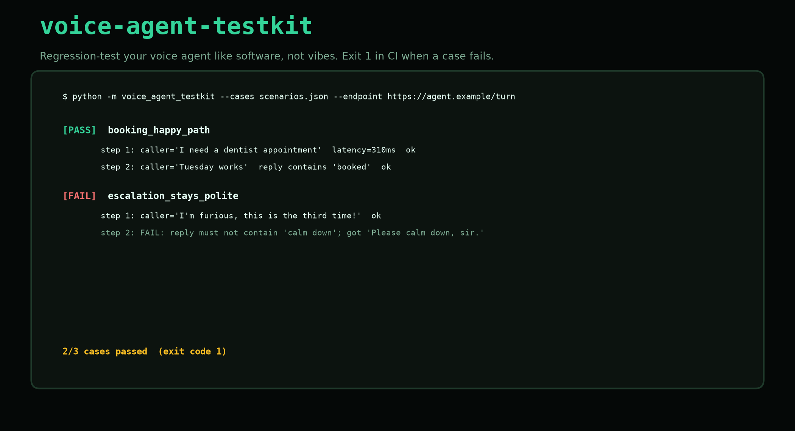

# voice-agent-testkit

Regression-test your voice agent like software, not vibes.



A voice agent changes every week: a new prompt, a new model, a new tool call.
Most teams hear about the regression from a customer. This tool lets you hear
about it from a test.

Write the caller's side as a scenario, point the runner at your agent
endpoint, and get a pass/fail report:

- **expect_contains / expect_not_contains**: the agent said what it should
- **max_latency_ms**: it said it fast enough
- **capture**: save a reply into a slot so later assertions can use it

## Quickstart

```bash
# stdlib only, nothing to install
python -m voice_agent_testkit --demo
```

```
[PASS] booking_happy_path
  step 1: caller='I need a dentist appointment' latency=250ms ok
  step 2: caller='Tuesday works' latency=250ms ok

1/1 cases passed
```

Run against a live agent:

```bash
python -m voice_agent_testkit --cases scenarios.json --endpoint https://your-agent.example/turn
```

The agent side is one interface: POST `{"utterance": ...}`, get back
`{"reply": ..., "latency_ms": ...}`. Swap in your real turn handler and the
same scenarios keep working.

## Exit codes

The CLI exits non-zero when any case fails, so it drops straight into CI.
Your voice agent gets the same regression gate your API already has.

## Status

Early. Roadmap: multi-turn slot assertions, audio-side testing (TTS voice
consistency), and a flake detector that re-runs failing cases to separate
prompt regressions from provider jitter.

MIT licensed. Built in public by [Dial AI Agent](https://dialaiagent.com).
